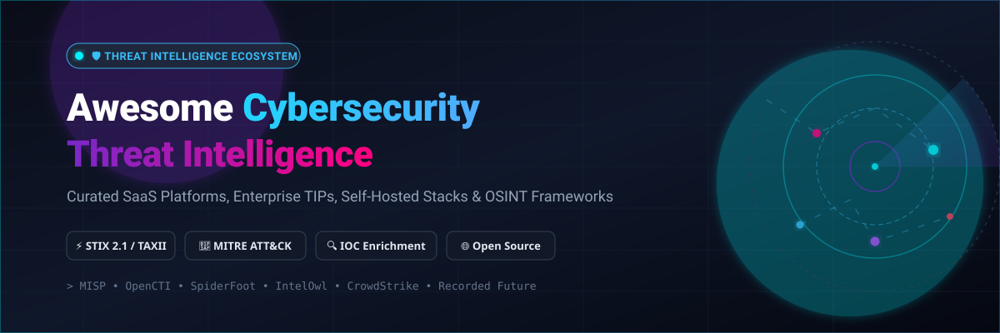

# 🛡️ Awesome Cybersecurity Threat Intelligence

  

  
  
  
  
  
  

---

## 🎯 Top Cybersecurity & Threat Intelligence Ecosystem

> ⚡ **Curated List of SaaS Platforms & Open-Source GitHub Projects**  
> 🔍 *Focused on CTI Management, Adversary Tracking, IOC Enrichment & Self-Hosted Intelligence Platforms (TIPs)*  
> 📅 **Last updated: March 2026**

This repository tracks top-tier **SaaS platforms** and **open-source projects** in **Cybersecurity & Cyber Threat Intelligence (CTI)**. These tools empower Security Operations Centers (SOCs), incident responders, and threat analysts to harvest, normalize, enrich, correlate, and operationalize adversary telemetry—ranging from enterprise intelligence feeds and dark web monitoring suites to sovereign, self-hosted Threat Intelligence Platforms (TIPs).

### 🌟 Key Highlights & Architectural Focus
- 📡 **STIX 2.1 & TAXII Standards**: Structured cyber threat modeling, sharing, and ecosystem interoperability.
- 🗂️ **Adversary & TTP Mapping**: Native integration with MITRE ATT&CK®, CAPEC, and TLP classification.
- 🔍 **Automated IOC Enrichment**: Multi-engine observable enrichment (IP, domain, hash, URL) across threat registries.
- 🏢 **Data Sovereignty vs Managed Feeds**: Transparent comparison of enterprise SaaS giants vs community self-hosted TIPs.

---

## 📑 Table of Contents
- [📊 Sector Overview & Market Dynamics](#-sector-overview--market-dynamics)
- [☁️ SaaS / Hosted Platforms](#️-saas--hosted-platforms)
- [💻 Open-Source GitHub Projects](#-open-source-github-projects)
- [🤝 How to Contribute](#-how-to-contribute)
- [💖 Support](#-support)
- [📈 Star History](#-star-history)
- [⚖️ Disclaimer](#️-disclaimer)

---

## 📊 Sector Overview & Market Dynamics

The global Cyber Threat Intelligence (CTI) market is estimated at approximately **$11.5B–$20.1B** and is projected to expand past **$50B+** into the 2030s (15–20% CAGR). The market structure is a **hybrid barbell**: it remains **highly fragmented** across specialized point feeds, dark web monitoring, and boutique IOC providers, while simultaneously experiencing **aggressive concentration and platform consolidation** around major cybersecurity titans (e.g., CrowdStrike, Google Cloud/Mandiant, Mastercard/Recorded Future) that bundle CTI directly into broad enterprise SecOps, SIEM, and XDR platforms.

---

## ☁️ SaaS / Hosted Platforms

| Platform | Market Size / Valuation | Starting Pricing | Free Tier / Trial Limits | Description |
| :--- | :--- | :--- | :--- | :--- |
| **[CrowdStrike Falcon Intelligence](https://www.crowdstrike.com/)** | **~$235B+ Market Cap** (~$5.39B ARR) | **$59.99/device/year** (Falcon Go entry tier; Falcon Intelligence bundle ~$166.56/license) | **15-Day Free Trial** (Full access to core NGAV and threat detection modules; no credit card required) | Adversary intelligence integrated directly with endpoint protection and unified Falcon platform telemetry. |
| **[Mandiant Advantage](https://www.mandiant.com/)** | **$5.4B Valuation** (Acquired by Google; ~$483M+ ARR pre-acquisition) | **~$75,000–$83,000/year** (Standard entry tier; custom contract scope) | **Permanent Free Tier** (Access limited to basic threat actor/malware profiles & CVE data; includes automatic 14-day full feature trial upgrade upon signup) | Threat intelligence backed by Google Cloud and frontline incident response investigations. |
| **[Recorded Future](https://www.recordedfuture.com/)** | **$2.65B Valuation** (Acquired by Mastercard; ~$300M ARR) | **$40,000–$50,000/year** (Single module entry; Microsoft Marketplace Threat User License starts at $50,000/year) | **No Free Tier** (14-to-30 day sales-assisted custom enterprise PoC trial available upon request for qualified organizations) | Real-time commercial intelligence platform aggregating open, deep, and dark web intelligence. |
| **[Flashpoint](https://flashpoint.io/)** | **~$100M ARR** (Venture-backed by Georgian & Greycroft) | **~$57,000/year** (Flashpoint Ignite entry contract median) | **No Free Tier** (Sales-assisted demo and structured enterprise proof-of-concept trial evaluation on request) | Deep and dark web intelligence specialist covering illicit forums, compromised credentials, and ransomware tracking. |
| **[Anomali](https://www.anomali.com/)** | **~$60M–$65M ARR** ($95M+ VC funding) | **~$90,000–$93,000/year** (ThreatStream base enterprise contract average) | **No Free Tier** (14-day enterprise proof-of-concept evaluation available upon sales approval) | Threat intelligence management and security analytics integrating feeds with enterprise SIEM/EDR. |
| **[ThreatConnect](https://threatconnect.com/)** | **~$40.4M ARR** ($22M+ VC funding) | **$45,000/year** (Starting TI Ops platform tier; community API starts at $19/mo) | **Permanent Free Community Tier** (Capped at 1–3 user seats, restricted historical data window, and excludes automated integrations) | Threat intelligence operations platform (TIP) featuring built-in analytics, orchestration, and risk quantification. |
| **[SOCRadar](https://socradar.io/)** | **~$120M–$130M Valuation** (~$30M–$35M ARR; Series B) | **$4,550/year** ($600/month for Advanced Dark Web Monitoring Essential; CTI Essential at $14,750/year) | **Permanent Free Tier** (Restricted to 1 corporate user, 1 corporate domain, 100 auto-discovered digital assets, and excludes API integrations) | Extended threat intelligence (XTI) platform with modular ASM, Dark Web Monitoring, and CTI feeds. |

---

## 💻 Open-Source GitHub Projects

Sorted descending by GitHub stargazers count:

- ### 🕷️ **[SpiderFoot](https://github.com/smicallef/spiderfoot)**   
  **Automated OSINT and external attack surface intelligence collection.** Integrates with over 200+ public and private threat data sources. Gathers technical telemetry on IP addresses, domain names, e-mail addresses, subnets, and hashes to identify data leaks, vulnerabilities, and adversary infrastructure.

- ### 🧠 **[OpenCTI](https://github.com/OpenCTI-Platform/opencti)**   
  **The leading open-source knowledge management platform for cyber threat intelligence.** Built natively on **STIX 2.1** and GraphQL, OpenCTI models complex relationships between threat actors, campaigns, incident observables, malware families, and infrastructure. Features an extensive ecosystem of ingestion connectors, automated playbooks, and visual relationship graphs.

- ### 🛡️ **[MISP (Malware Information Sharing Platform)](https://github.com/MISP/MISP)**   
  **The international standard open-source platform for threat sharing and IOC correlation.** Open software, formats, and REST APIs for exchanging indicators of compromise, vulnerabilities, and financial fraud data across trusted circles. Includes pre-built taxonomies and galaxies for **MITRE ATT&CK**, **TLP**, Ransomware, and Threat Actors, with native sync between distributed MISP instances.

- ### 🦉 **[IntelOwl](https://github.com/intelowlproject/IntelOwl)**   
  **Scalable, asynchronous IOC enrichment engine.** Single-API orchestrator that queries dozens of external analyzers (VirusTotal, AbuseIPDB, GreyNoise, Shodan, OTX, MISP) to enrich observables (IPs, domains, hashes, files) in seconds. Features an extensible plugin architecture with playbooks, pivots, ingestion queues, and modern dashboards.

- ### 🗺️ **[MITRE CTI (ATT&CK in STIX)](https://github.com/mitre/cti)**   
  **Official MITRE Cyber Threat Intelligence repository expressed in STIX 2.0 / 2.1.** Provides structured machine-readable knowledge bases for **Enterprise ATT&CK**, **Mobile ATT&CK**, and **ICS ATT&CK**, enabling security tools to programmatically correlate observed adversarial techniques, tactics, and mitigations.

- ### 🚨 **[FIR (Fast Incident Response)](https://github.com/certsocietegenerale/FIR)**   
  **Cybersecurity incident response and investigation platform designed for CSIRTs and SOCs.** Created by CERT Société Générale, FIR tracks security incidents, affected business assets, and associated threat indicators, serving as an actionable operational bridge between incoming threat intelligence and active remediation.

- ### 🐾 **[Yeti](https://github.com/yeti-platform/yeti)**   
  **Your Everyday Threat Intelligence platform tailored for DFIR analysts.** Designed as a unified repository to organize observables, TTPs, and indicators originating from incident response triage. Automatically enriches data, resolves domain histories, and outputs structured intelligence feeds directly consumed by SIEMs and detection systems.

- ### ⚓ **[Harpoon](https://github.com/Te-k/harpoon)**   
  **CLI Swiss Army knife for threat intelligence analysts and OSINT investigations.** Automates command-line queries across over 50 threat intelligence platforms and search engines including VirusTotal, Censys, Shodan, SecurityTrails, AlienVault OTX, URLhaus, and Hybrid Analysis.

- ### 🔍 **[AIL Framework](https://github.com/AIL-project/ail-framework)**   
  **Analysis Information Leak framework for unstructured data streams.** Open-source modular framework developed to crawl, parse, and analyze potential data leaks, paste sites, and dark web/Tor hidden services in real time, detecting credential exposure, sensitive tokens, and indicators.

- ### 📥 **[ThreatIngestor](https://github.com/InQuest/ThreatIngestor)**   
  **Automated threat intelligence extraction and aggregation pipeline.** Ingests unstructured threat data from Twitter/X, RSS feeds, GitHub repositories, and email alerts, extracts IOCs (IPs, domains, hashes, CVEs, YARA rules), and automatically exports structured indicators into MISP, OpenCTI, or custom webhook endpoints.

- ### 🧩 **[MISP Modules](https://github.com/MISP/misp-modules)**   
  **Autonomous expansion, enrichment, import, and export microservices for MISP.** Extends core MISP with dozens of microservices for on-the-fly indicator expansion (DNS, WHOIS, VirusTotal, passive SSL, PDF/STIX import/export), maximizing contextual threat data depth.

---

## 🤝 How to Contribute

1. 🍴 Fork the repository.
2. 📝 Add or update entries in `README.md` (ensure factual accuracy, current pricing, and official repository links).
3. 📌 Follow the existing table/list structure and include Stars_Counts/badges where applicable.
4. 🚀 Submit a Pull Request with a clear description of changes.

---

## 💖 Support

Thank you so much for exploring and supporting **Awesome Cybersecurity Threat Intelligence**! 🙏

If you find this repository valuable for your security research, SOC operations, or threat intelligence engineering:
- ⭐ **Star this repository** to help others discover it!
- 🍴 **Fork it** to customize it for your team or contribute new tools.
- 📢 **Share it** with fellow infosec professionals, analysts, and cybersecurity communities.
- ☕ **Buy a coffee / Sponsor**: If you would like to support ongoing maintenance and new threat intelligence research lists, please consider sponsoring via the **[GitHub Sponsor Dashboard](https://github.com/sponsors/ishandutta2007)**. Every bit of support is deeply appreciated!

---

## 📈 Star History

---

## ⚖️ Disclaimer

- This repository is a **community-curated index** compiled for informational, educational, and operational defense purposes only.
- Mention of specific commercial products or open-source repositories does not constitute an official endorsement.
- **Total Cost of Ownership (TCO)**: While open-source TIPs (MISP, OpenCTI) eliminate software licensing fees, infrastructure hosting, maintenance, connector development, and analyst overhead must be accounted for.
- Commercial pricing is subject to vendor negotiation, usage tiers, and contract renewals. Please verify directly with vendors before procurement.

---

  <b>Built for SOC analysts, CTI researchers, and cybersecurity engineers worldwide. 🛡️</b>

